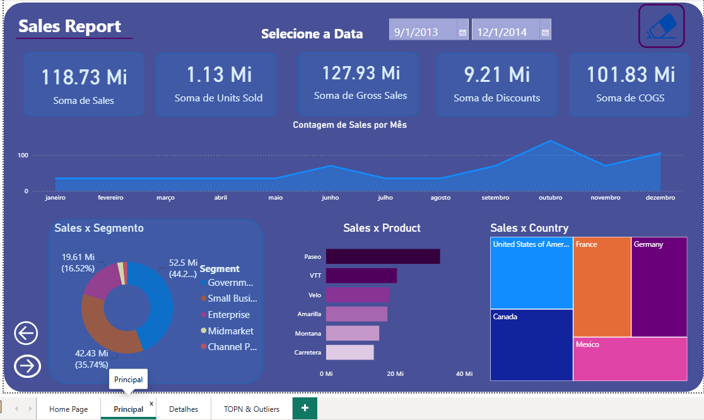
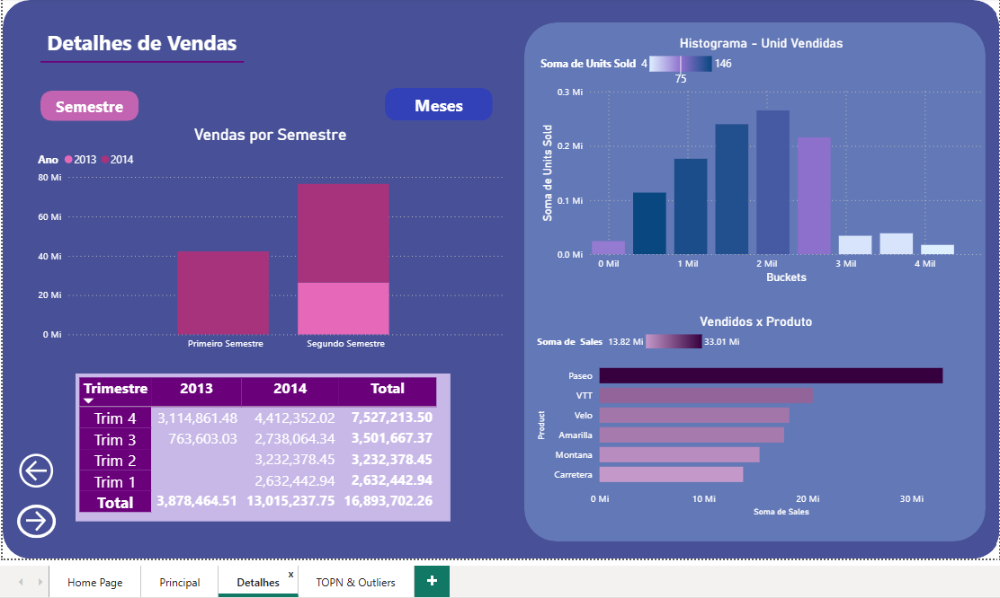
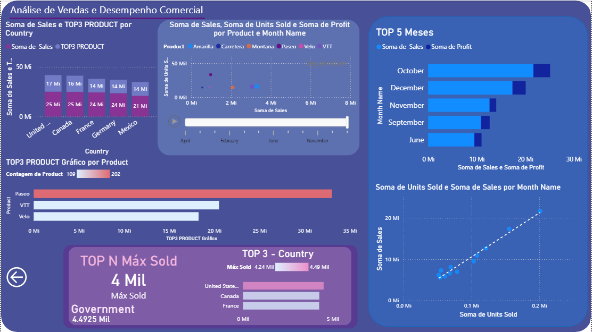

# 📊 Dashboard de Análise de Vendas | Power BI

Projeto desenvolvido durante os estudos de Business Intelligence na **DIO (Digital Innovation One)**, utilizando Power BI para transformar dados comerciais em dashboards interativos e análises de desempenho.

## 🎯 Objetivo do projeto

Desenvolver um relatório interativo para acompanhar indicadores comerciais, analisar vendas por produto, país e período, identificar tendências e apoiar a tomada de decisões baseada em dados.

## 🖥️ Visualizações do Dashboard

### 📌 Página 1 — Home Page

Página inicial desenvolvida para apresentar o projeto e facilitar a navegação entre as análises disponíveis.

### 📌 Página 2 — Dashboard Principal

Visão geral dos indicadores de vendas e desempenho comercial, com gráficos interativos para acompanhar os principais resultados.

### 📌 Página 3 — Análise Detalhada

Visualizações complementares para explorar os dados e comparar diferentes indicadores comerciais.

### 📌 Página 4 — Sales Performance | Análise de Vendas

Análise avançada com rankings Top N, indicadores de vendas máximas, comparação entre países e produtos, gráficos de dispersão e animação temporal.

**Principais recursos:**
- TOP 5 meses por faturamento e lucro.
- TOP 3 países e produtos.
- Comparação de vendas por país.
- Indicadores DAX de valores máximos.
- Gráfico de dispersão com linha de tendência.
- Análise por produto e mês com eixo de reprodução.
- Formatação condicional com gradientes.

## 🔗 Acesse o projeto

📁 **[Acessar arquivo Power BI](<Projetofinal.pbix>)**

## 🛠️ Tecnologias utilizadas

- Microsoft Power BI Desktop
- Power Query
- DAX (Data Analysis Expressions)
- Modelagem e análise de dados
- Filtros e segmentações interativas
- Gráficos de dispersão e linhas de tendência
- Formatação condicional e Data Visualization

## 🚀 Evolução do projeto

Durante o desenvolvimento, foram implementadas melhorias na organização visual, criação de indicadores personalizados e utilização de recursos de interatividade.

As novas páginas ampliaram as possibilidades de análise, permitindo explorar o desempenho comercial sob diferentes perspectivas e períodos.

## 💡 Aprendizados

O projeto proporcionou experiência prática na construção de dashboards, criação de medidas DAX, organização de informações, análise de indicadores comerciais e desenvolvimento de visualizações voltadas à tomada de decisão.

---

**Desenvolvido por Deborah dos Santos | DIO — Power BI**

